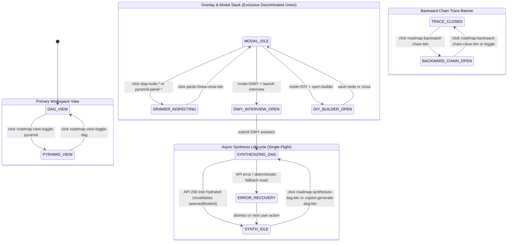
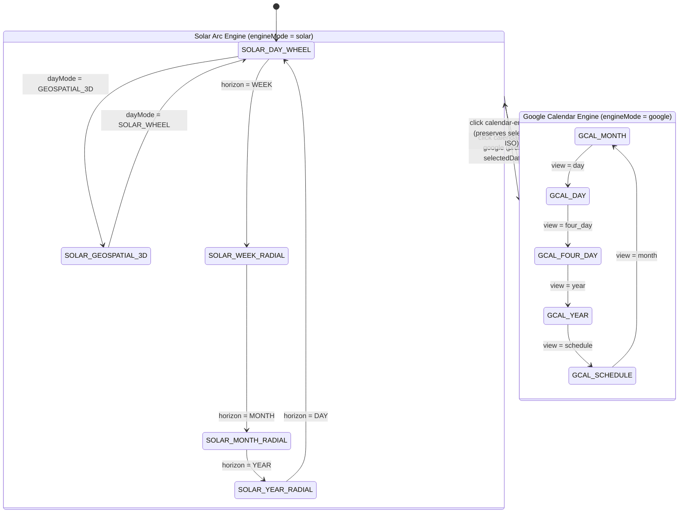
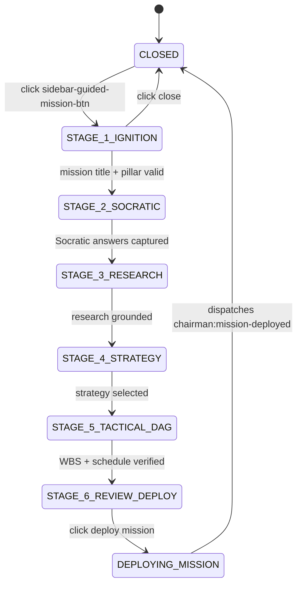

# Canonical State-Chart Templates — Chairman Dashboard

Use these `stateDiagram-v2` patterns when authoring Before/After state charts in `walkthrough.md`.

## 1. Strategic Roadmap (`/roadmaps`) Canonical State Machine

## 2. Master Calendar (`/calendar`) Engine & Horizon State Machine

## 3. Guided Mission Flow Navigator (`MissionFlowNavigatorModal`)

