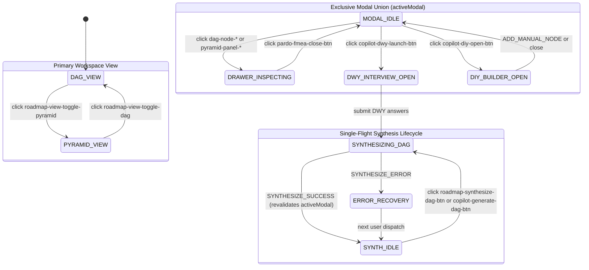
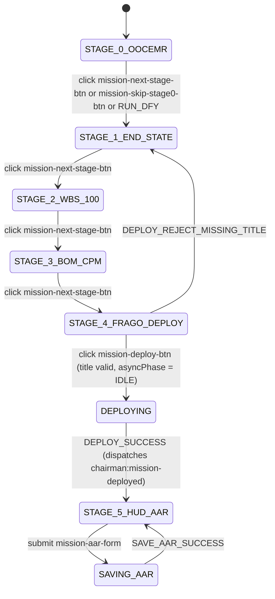
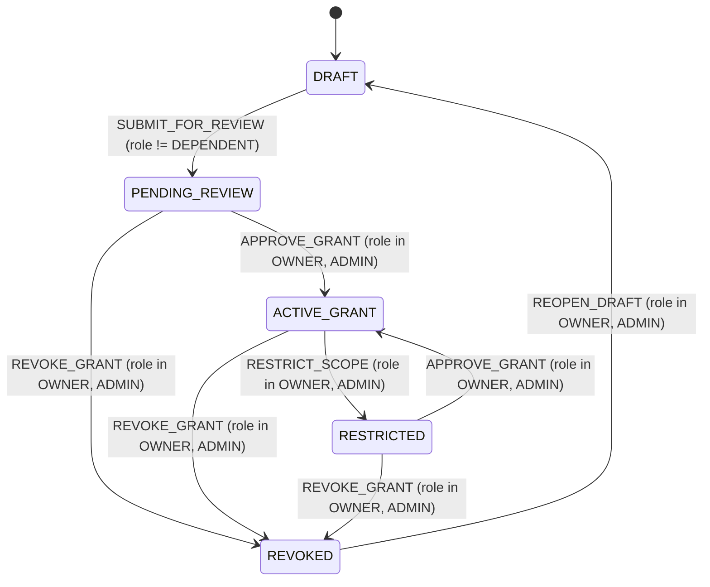

# Canonical State-Chart Templates — Chairman Dashboard v3.0

## 1. Strategic Roadmap (`/roadmaps`) State Machine

## 2. Guided Mission Flow Navigator (`MissionFlowNavigatorModal` 6-Stage Reducer)

## 3. Zero-Trust Pod Consent & RBAC Governance Lifecycle

